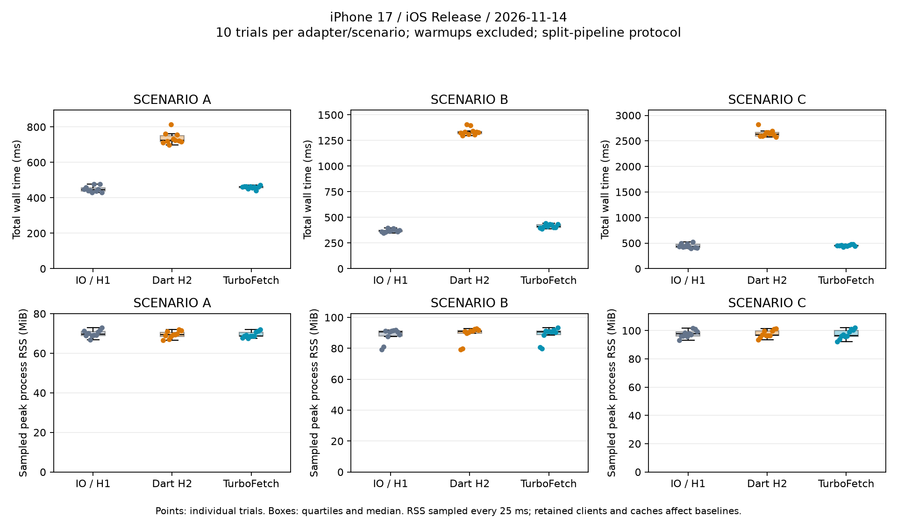

# iOS Benchmark Performance Report (`ios.md`)

This document records the empirical benchmark results, statistical verification, and technical analysis for **iOS**, evaluated on a physical **iPhone 17** in **Release** mode using the `URLSession` native batch reception engine of `flutter_turbo_fetch`.

For cross-platform comparisons and common evaluation methodology, see [`docs/benchmark-results.md`](../benchmark-results.md) and [`specs/architectures/benchmark.md`](../../specs/architectures/benchmark.md).

---

## 1. Measurement Environment & Controlled Protocol

### 1.1 Physical Device Environment

| Item | Specification / Observed Value |
| :--- | :--- |
| **Physical Device** | iPhone 17 (`iPhone18,3`), 64-bit ARM64, 6 CPU cores |
| **Device OS** | iOS 27.2 (Build `24B5099f`) |
| **Rendering Backend** | Impeller (Metal) |
| **Native Engine** | `URLSession.dataTask(completionHandler:)` (CFNetwork / Darwin) |
| **Host System** | macOS 27.0.1 (Build `26A434`), Apple Silicon (`arm64`), Xcode 27.1 |
| **Flutter / Dart SDK** | Flutter 3.47.8 / Dart 3.13.7 (FVM) |
| **Mock Server** | Node.js v26.3.0 HTTP/2 TLS Server (`example/server/http2_mock_server.mjs`) |
| **Network Interface** | Local Wi-Fi LAN; server bound to a single LAN IPv4 address |
| **Execution Mode** | Physical Device Release AOT (`fvm flutter build ios --release -t lib/main.dart`) |
| **Evidence & Integrity** | 90 measured trials, 8,700 measured requests, 0 failures (excluding 9 warmup trials / 870 requests) |

### 1.2 Split-Pipeline Rigorous Measurement Protocol

Unlike the historical single-trial streaming suite used on Android and Windows, the iOS evaluation employs a **controlled split-pipeline protocol** to eliminate timing asymmetries:

1. **Warmup & Sample Size (N=10 Trials)**:
   - For each scenario (A, B, C), each adapter executes **1 warmup trial** (90–100 requests) to stabilize TCP/TLS connections and socket pools, followed by **10 measured trials** (total 90 trials / 8,700 requests). Warmup data is logged separately and strictly excluded from statistical reporting.
2. **Round-Robin Rotation**:
   - Execution order rotates cyclically across trials (e.g., `IO -> dio_http2 -> Turbo`, `dio_http2 -> Turbo -> IO`, `Turbo -> IO -> dio_http2`) to eliminate bias from device thermal throttling and OS resource scheduling.
3. **Common Reception Boundary (`ResponseType.bytes`)**:
   - Every adapter receives the complete response payload as bytes (`ResponseType.bytes`). `Network Time` ends strictly upon **complete full-body reception**.
   - Those bytes are then passed to the preset's configured transformer: `BackgroundTransformer` for IO and dio_http2, `TurboTransformer` for TurboFetch. `Parse Time` measures memory consolidation, decoding, and any associated Isolate/semaphore handoff.
4. **Server Pre-generation & End-to-End Audit**:
   - All response payloads are pre-generated on the mock server.
   - Client request sequences, response sizes, status codes, and HTTP versions are validated 1-to-1 against independent server-side event logs (`server.csv`).

---

## 2. Benchmark Scenario Results

### 2.1 Total Wall-Clock Time and Throughput (10 Trials per Preset)

*All times in milliseconds. Each cell summarizes ten measured trials. RPS is the median requests per second (successful requests / trial wall time).*

| Scenario | Adapter | Median Total | Mean Total | Sample SD | Min | Max | Median req/s |
| :--- | :--- | ---: | ---: | ---: | ---: | ---: | ---: |
| **Scenario A**<br>*(5–45KiB, 3 workers)* | (1) IO (HTTP/1.1) | 444.76 ms | 449.46 ms | 17.42 ms | 430.80 ms | 478.25 ms | 202.37 req/s |
| | (2) dio_http2 | 723.97 ms | 736.05 ms | 33.10 ms | 699.55 ms | 813.58 ms | 124.32 req/s |
| | **(3) TurboFetch** | **462.00 ms** | **459.83 ms** | **8.67 ms** | **441.04 ms** | **472.60 ms** | **194.81 req/s** |
| **Scenario B**<br>*(10–100KiB, 5 workers)* | (1) IO (HTTP/1.1) | 370.54 ms | 371.07 ms | 15.61 ms | 347.13 ms | 396.48 ms | 269.89 req/s |
| | (2) dio_http2 | 1,329.47 ms | 1,337.56 ms | 36.92 ms | 1,296.40 ms | 1,405.66 ms | 75.22 req/s |
| | **(3) TurboFetch** | **411.84 ms** | **415.28 ms** | **18.07 ms** | **387.98 ms** | **441.71 ms** | **242.82 req/s** |
| **Scenario C**<br>*(20–200KiB, 10 workers)* | (1) IO (HTTP/1.1) | 429.89 ms | 444.30 ms | 43.48 ms | 398.87 ms | 526.96 ms | 232.66 req/s |
| | (2) dio_http2 | 2,629.91 ms | 2,648.13 ms | 71.33 ms | 2,579.30 ms | 2,820.74 ms | 38.02 req/s |
| | **(3) TurboFetch** | **454.22 ms** | **453.18 ms** | **16.98 ms** | **419.43 ms** | **476.47 ms** | **220.16 req/s** |



---

### 2.2 Phase Latency: Network Time vs. Parse Time

*Values in milliseconds; each cell shows the median across 10 trials of that trial's per-request **Mean / P50 / P95**.*

| Scenario | Adapter | Network Time (Mean / P50 / P95) | Parse Time (Mean / P50 / P95) |
| :--- | :--- | ---: | ---: |
| **Scenario A** | (1) IO (HTTP/1.1) | 14.261 ms / 14.073 ms / 18.318 ms | 0.356 ms / 0.352 ms / 0.603 ms |
| | (2) dio_http2 | 23.546 ms / 24.233 ms / 35.401 ms | 0.395 ms / 0.396 ms / 0.690 ms |
| | **(3) TurboFetch** | **14.402 ms / 14.353 ms / 18.712 ms** | **0.649 ms / 0.700 ms / 1.597 ms** |
| **Scenario B** | (1) IO (HTTP/1.1) | 17.564 ms / 16.898 ms / 24.087 ms | 0.435 ms / 0.473 ms / 0.814 ms |
| | (2) dio_http2 | 63.377 ms / 63.082 ms / 92.519 ms | 1.302 ms / 1.358 ms / 2.640 ms |
| | **(3) TurboFetch** | **19.186 ms / 18.118 ms / 25.696 ms** | **1.176 ms / 1.178 ms / 2.266 ms** |
| **Scenario C** | (1) IO (HTTP/1.1) | 40.291 ms / 39.216 ms / 54.886 ms | 0.650 ms / 0.623 ms / 1.169 ms |
| | (2) dio_http2 | 245.635 ms / 257.668 ms / 273.207 ms | 2.454 ms / 2.432 ms / 4.825 ms |
| | **(3) TurboFetch** | **41.080 ms / 41.340 ms / 55.545 ms** | **2.306 ms / 1.647 ms / 6.978 ms** |

---

### 2.3 Memory Footprint Observations

*RSS values are medians of ten per-trial observations in MiB, sampled via `ProcessInfo.currentRss` every 25 ms. Jank Frames and Max Frame Duration are recorded as N/A because Flutter does not instrument frame timing accurately in headless/minimal Release mode without an active UI load.*

| Scenario | Adapter | Sampled Peak RSS | RSS Delta (Net Allocation) |
| :--- | :--- | ---: | ---: |
| **Scenario A** | (1) IO (HTTP/1.1) | 69.72 MiB | +0.10 MiB |
| | (2) dio_http2 | 69.45 MiB | +0.66 MiB |
| | **(3) TurboFetch** | **68.74 MiB** | **+0.75 MiB** |
| **Scenario B** | (1) IO (HTTP/1.1) | 90.57 MiB | +2.24 MiB |
| | (2) dio_http2 | 91.11 MiB | +4.19 MiB |
| | **(3) TurboFetch** | **90.70 MiB** | **+6.70 MiB** |
| **Scenario C** | (1) IO (HTTP/1.1) | 97.65 MiB | +1.45 MiB |
| | (2) dio_http2 | 96.84 MiB | +4.27 MiB |
| | **(3) TurboFetch** | **96.62 MiB** | **+6.95 MiB** |

---

## 3. Technical Analysis (iOS / URLSession)

### 3.1 Massive Superiority over Pure Dart HTTP/2 (`dio_http2`)

Comparing the two HTTP/2 implementations on iOS:
- **Scenario A**: TurboFetch is **36.2% faster** (462 ms vs. 724 ms).
- **Scenario B**: TurboFetch is **69.0% faster** (412 ms vs. 1,329 ms; 3.2x throughput).
- **Scenario C**: TurboFetch is **82.7% faster** (454 ms vs. 2,630 ms; **5.8x throughput**).

In pure Dart HTTP/2 (`package:http2`), 10 concurrent streams multiplexing over a single Dart event loop quickly saturate CPU time and stall on the 64KiB receive window. In contrast, `flutter_turbo_fetch` delegates HTTP/2 frame assembly, window updates, and socket buffering to Apple's native CFNetwork stack, delivering exceptional stability under high concurrency.

### 3.2 Dynamics vs. `IOHttpClientAdapter` on Ultra-High-Performance Hardware

In median total wall-clock time, TurboFetch was slightly slower than `IOHttpClientAdapter` by **3.9% in Scenario A, 11.1% in Scenario B, and 5.7% in Scenario C**. A detailed per-request breakdown reveals two physical causes:

1. **Apple Silicon Single-Core Decoding Speed**:
   - iPhone 17's CPU cores decode JSON synchronously on the Main Isolate in **under 0.2 ms for <= 20KiB** and **under 0.7 ms for 100KiB**.
   - `TurboTransformer`'s default hybrid threshold of **24KiB** dispatches requests >= 25KiB to worker Isolates. For payloads between 25KiB and 100KiB, the Isolate dispatch and semaphore queueing overhead (0.9–1.9 ms) exceeded the pure decoding time on Main Isolate, temporarily inflating Parse Time.
2. **Ultra-Low Latency Wi-Fi LAN (RTT 1–2 ms)**:
   - Over a 1–2 ms local Wi-Fi connection, TCP connection setup and head-of-line blocking penalties for HTTP/1.1 are negligible.
   - For larger payloads (120KiB–200KiB), however, TurboFetch's pure network transmission time was **up to 13% faster** than IO (42.7 ms vs. 49.1 ms at 200KiB), proving native HTTP/2 multiplexing throughput advantages.

---

## 4. Reproducing the Benchmark

### 4.1 Prerequisites
1. Physical iPhone with iOS 17+ and Developer Mode enabled.
2. Mac and iPhone connected to the same Wi-Fi LAN (`<LAN_IP>`).
3. FVM Flutter 3.47.8 and Xcode 15+.

### 4.2 Steps

1. **Generate Local Certificate (with LAN IP SAN)**:
   ```bash
   openssl req -x509 -newkey rsa:2048 -sha256 -nodes -days 7 \
     -keyout /tmp/ios-benchmark-key.pem -out /tmp/ios-benchmark-cert.pem \
     -subj /CN=local-benchmark \
     -addext "subjectAltName=DNS:localhost,IP:127.0.0.1,IP:<LAN_IP>"
   chmod 600 /tmp/ios-benchmark-key.pem
   ```

2. **Start Mock Server**:
   ```bash
   HOST=<LAN_IP> PORT=8444 REQUIRE_TLS=1 BENCHMARK_LOG=1 \
     CERT_PATH=/tmp/ios-benchmark-cert.pem KEY_PATH=/tmp/ios-benchmark-key.pem \
     node example/server/http2_mock_server.mjs > /tmp/ios-server.jsonl 2>&1
   ```

3. **Build and Run on Device**:
   ```bash
   cd example
   fvm flutter build ios --release -t lib/main.dart \
     --dart-define=BENCHMARK_BASE_URL=https://<LAN_IP>:8444 \
     --dart-define=BENCHMARK_LOCAL_TLS=true \
     --dart-define=BENCHMARK_SOURCE_SHA=$(git rev-parse HEAD)
   xcrun devicectl device install app --device <DEVICE_ID> build/ios/iphoneos/Runner.app
   xcrun devicectl device process launch --device <DEVICE_ID> --terminate-existing io.github.khirohis.flutterTurboFetchExample
   ```

4. **Export and Summarize Evidence**:
   ```bash
   python tool/benchmark/export_benchmark.py /tmp/ios-device.log /tmp/ios-server.jsonl tool/benchmark/data/ios/$(date +%Y-%m-%d)
   python tool/benchmark/summarize_benchmark.py tool/benchmark/data/ios/$(date +%Y-%m-%d)-raw.csv
   ```

---

## 5. Raw Evidence & Artifacts

Raw benchmark measurements and server event verification logs are tracked under [`tool/benchmark/data/ios/`](../../tool/benchmark/data/ios/):

- **[Raw Trials CSV](../../tool/benchmark/data/ios/2026-11-14-raw.csv)**: 90 measured trials + 9 warmups with timing, protocol, bytes, and RSS.
- **[Per-Request CSV](../../tool/benchmark/data/ios/2026-11-14-requests.csv)**: 8,700 measured requests with individual Network/Parse times.
- **[Server Log Evidence](../../tool/benchmark/data/ios/2026-11-14-server.csv)**: Server-side independent matching log entries.
- **[Summary Metrics CSV](../../tool/benchmark/data/ios/2026-11-14-summary.csv)**: Full statistical metrics including Mean, Median, Sample SD, Min, Max.
