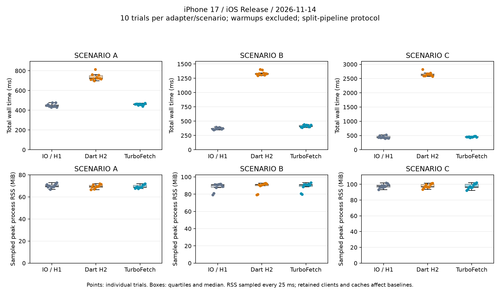

# iOS physical-device Release benchmark — 2026-11-14

**Completed: 90 measured trials, 8,700 successful measured requests, zero failures.**
Nine additional warmup trials (870 requests) are explicitly excluded from statistics.
This is a controlled **split-pipeline** comparison on one iPhone and one local
Wi-Fi network, not a universal claim about production Dio performance.

TurboFetch had lower median total time than `dio_http2_adapter` in A/B/C, but
higher median total time than `IOHttpClientAdapter` in all three scenarios.
Frame smoothness was not measured; no zero-jank claim follows from this study.

## Environment and provenance

| Item | Observed value |
| --- | --- |
| Physical device | iPhone 17 (`iPhone18,3`), ARM64, six CPU cores |
| Device OS | iOS 27.2, build `24B5099f` |
| Host | macOS 27.0.1, build `26A434`, Apple Silicon (`arm64`) |
| Flutter | FVM 3.47.8, framework `737ba8f885` |
| Dart | 3.13.7 |
| Xcode | 27.1, build `27A9275` |
| Node.js | 26.3.0 |
| Plugin version | 0.0.4 |
| Unchanged plugin base source | `5f45f4ad1bb27dcf08f7daf9460f2f448d557a95` |
| Measurement app and server source | `980b7961e6a8dacf49c9dd7b4ba15099906f6cd3` |
| Dio / dio_http2_adapter / http2 | 5.11.1 / 2.9.0 / 2.3.1 |
| Session start | 2026-11-14 03:39:19.566 UTC / 12:39:19.566 JST |
| Build and deployment | Physical-device Release; installed and launched over USB |
| HTTP data path | Local Wi-Fi LAN; Mac server bound to one specific LAN IPv4 address |
| TLS | Short-lived self-signed certificate with matching LAN-IP SAN; local certificate bypass enabled equally for all three app clients |
| Host preflight | Certificate and SAN validated using an explicit CA file; HTTP/1.1 and HTTP/2 bodies matched |
| Server-observed protocols | IO: HTTP/1.1; dio_http2 and TurboFetch: HTTP/2 with ALPN `h2` |

Device identifiers, personal device names, LAN addresses/SSID, signing identities,
keys, and certificates are omitted from public evidence. The USB connection was
retained. Device power mode, battery level, temperature, thermal state, actual
refresh rate, signal strength, and other LAN traffic were not recorded or controlled.
The host performed no package installation/build or device-log transfer during
this published session; lightweight server-log progress checks continued.

## Workload and measurement boundaries

The [protocol and reproduction steps](README.md) define the three presets,
retained clients, warmups, rotated order, TLS settings, and collection commands.
Each adapter/scenario receives one full-workload warmup, followed by ten full
measured trials. Each full trial already contains ten size sweeps; those inner
sweeps are not counted as independent trials.

| Scenario | Requested sizes | Concurrency | Requests/trial | Measured requests/adapter |
| --- | --- | ---: | ---: | ---: |
| A | 5–45 KiB, steps of 5 | 3 | 90 | 900 |
| B | 10–100 KiB, steps of 10 | 5 | 100 | 1,000 |
| C | 20–200 KiB, steps of 20 | 10 | 100 | 1,000 |

All adapters receive the same pre-generated UTF-8 JSON bodies, with no compression
or artificial delay, and decode every response without custom model mapping.
The generator appends whole records, so requested KiB is a lower bound, not the
actual byte count. Actual sizes range from 6,729 to 206,739 bytes and match across
all adapters and both sides of the connection for each requested size.

Network time includes the Dio call through **complete byte-body reception**.
Those bytes are then passed to the preset's JSON transformer: `BackgroundTransformer`
for IO and dio_http2, `TurboTransformer` for TurboFetch. Parse time excludes
socket reads but includes transformer/Isolate overhead. Total wall time includes
worker scheduling and JSON shape validation. The common synchronous byte stage
changes buffering and allocations compared with the normal Dio JSON pipeline;
these phase times must not be interpreted as pure wire latency or parser CPU cost.

## Evidence and validation

- [Raw trial CSV](2026-11-14-raw.csv): 99 rows, including nine labeled warmups;
  90 measured rows, with source SHA, times, success counts, bytes, protocol, and RSS.
- [Per-request CSV](2026-11-14-requests.csv): 9,570 rows, including 870 warmup
  requests and 8,700 measured requests; no request failures in this session.
- [Server evidence CSV](2026-11-14-server.csv): independently logged matching
  request identifiers, byte counts, protocol, ALPN, and status for all 9,570 requests.
- [Summary CSV](2026-11-14-summary.csv): per-scenario/adapter mean, median,
  sample standard deviation, minimum, and maximum for every numeric performance
  metric, including Network/Parse averages/P50/P95, RPS, Total, and RSS.
  Frame metrics have `n=0` and `N/A` values.

The exporter requires a completed Release session, unique and complete trial keys,
zero failed requests, expected HTTP protocols, `h2` ALPN for HTTP/2, matching
server/device request counts and byte lengths, and equal payload lengths across
adapters. No missing observations are replaced with zero. Each adapter completed
2,900/2,900 measured requests (100%); each scenario/adapter completed all ten trials.
IO's server ALPN field is `False` (no negotiated ALPN), while its observed request
protocol is HTTP/1.1; the HTTP version is not inferred from the preset name.



## Total time and throughput

All times are milliseconds. Each row summarizes ten measured trials. RPS is the median of per-trial successful requests divided by trial wall time.

| Scenario | Adapter | Median total | Mean total | Sample SD | Min | Max | Median req/s |
| --- | --- | ---: | ---: | ---: | ---: | ---: | ---: |
| A | IO / HTTP/1.1 | 444.76 | 449.46 | 17.42 | 430.80 | 478.25 | 202.37 |
| A | dio_http2 | 723.97 | 736.05 | 33.10 | 699.55 | 813.58 | 124.32 |
| A | TurboFetch | 462.00 | 459.83 | 8.67 | 441.04 | 472.60 | 194.81 |
| B | IO / HTTP/1.1 | 370.54 | 371.07 | 15.61 | 347.13 | 396.48 | 269.89 |
| B | dio_http2 | 1329.47 | 1337.56 | 36.92 | 1296.40 | 1405.66 | 75.22 |
| B | TurboFetch | 411.84 | 415.28 | 18.07 | 387.98 | 441.71 | 242.82 |
| C | IO / HTTP/1.1 | 429.89 | 444.30 | 43.48 | 398.87 | 526.96 | 232.66 |
| C | dio_http2 | 2629.91 | 2648.13 | 71.33 | 2579.30 | 2820.74 | 38.02 |
| C | TurboFetch | 454.22 | 453.18 | 16.98 | 419.43 | 476.47 | 220.16 |

## Network and JSON transformation

Milliseconds; each cell is the median across ten trials of that trial's request mean/P50/P95. These are not percentiles pooled across all requests. Network ends at full-body reception; Parse includes transformer scheduling, stream consolidation, decoding, and applicable Isolate/semaphore overhead.

| Scenario | Adapter | Network avg / P50 / P95 | Parse avg / P50 / P95 |
| --- | --- | ---: | ---: |
| A | IO / HTTP/1.1 | 14.261 / 14.073 / 18.318 | 0.356 / 0.352 / 0.603 |
| A | dio_http2 | 23.546 / 24.233 / 35.401 | 0.395 / 0.396 / 0.690 |
| A | TurboFetch | 14.402 / 14.353 / 18.712 | 0.649 / 0.700 / 1.597 |
| B | IO / HTTP/1.1 | 17.564 / 16.898 / 24.087 | 0.435 / 0.473 / 0.814 |
| B | dio_http2 | 63.377 / 63.082 / 92.519 | 1.302 / 1.358 / 2.640 |
| B | TurboFetch | 19.186 / 18.118 / 25.696 | 1.176 / 1.178 / 2.266 |
| C | IO / HTTP/1.1 | 40.291 / 39.216 / 54.886 | 0.650 / 0.623 / 1.169 |
| C | dio_http2 | 245.635 / 257.668 / 273.207 | 2.454 / 2.432 / 4.825 |
| C | TurboFetch | 41.080 / 41.340 / 55.545 | 2.306 / 1.647 / 6.978 |

## Memory and frame observations

RSS values are medians of ten per-trial observations in MiB. The 25 ms RSS sampler can miss short peaks; RSS is process-wide. Jank Frames and Max Frame Duration are **N/A for every run**: this protocol did not instrument frames or perform a separate Profile study.

| Scenario | Adapter | Sampled peak RSS | RSS delta |
| --- | --- | ---: | ---: |
| A | IO / HTTP/1.1 | 69.72 | 0.10 |
| A | dio_http2 | 69.45 | 0.66 |
| A | TurboFetch | 68.74 | 0.75 |
| B | IO / HTTP/1.1 | 90.57 | 2.24 |
| B | dio_http2 | 91.11 | 4.19 |
| B | TurboFetch | 90.70 | 6.70 |
| C | IO / HTTP/1.1 | 97.65 | 1.45 |
| C | dio_http2 | 96.84 | 4.27 |
| C | TurboFetch | 96.62 | 6.95 |

## Interpretation

Ratios below compare **median trial wall times**, not paired confidence estimates:

- **Scenario A:** TurboFetch 462.00 ms versus IO 444.76 ms and dio_http2
  723.97 ms. TurboFetch took 3.9% longer than IO and 36.2% less time than dio_http2.
- **Scenario B:** TurboFetch 411.84 ms versus IO 370.54 ms and dio_http2
  1,329.47 ms. TurboFetch took 11.1% longer than IO and 69.0% less time than dio_http2.
- **Scenario C:** TurboFetch 454.22 ms versus IO 429.89 ms and dio_http2
  2,629.91 ms. TurboFetch took 5.7% longer than IO and 82.7% less time than dio_http2.

IO had the lowest median wall time in all three scenarios. HTTP/2 alone did not
establish a speed advantage for these LAN workloads. TurboFetch's measured
network intervals were close to IO's and shorter than dio_http2's; this does not
isolate the underlying cause, such as flow control or runtime scheduling.

TurboFetch had higher median per-trial mean Parse time than IO in every scenario.
Its median Parse P95 was also higher, including 6.978 ms in C versus IO's 1.169 ms
and dio_http2's 4.825 ms. The Isolate threshold and scheduling costs are plausible
contributors, but this study did not trace them and cannot establish causation.

Median sampled process RSS peaks were broadly similar within each scenario.
TurboFetch had larger median RSS deltas than both alternatives in all scenarios;
absolute RSS and delta baselines include retained clients, prior allocations,
GC, native networking, and runtime caches. These observations do not support a
claim that TurboFetch uses less memory, nor do they measure per-request allocations.
TurboFetch's total-time sample standard deviation was smaller than the others
in A and C, but larger than IO's in B. One short session does not establish
long-term reproducibility or statistical superiority.

## Measurement audit and preparation failures

The original example's `fetch()` boundary ends at headers for streaming adapters,
but after full reception for TurboFetch. Its Network/Parse phase values are not
directly comparable. Missing timing keys, empty successful samples, unavailable
RSS, and absent frames may also appear as zero in its existing UI. The dedicated
entry point avoids using those misleading phase summaries and missing values.
Library transport implementation and historical platform measurements were not changed.

Preparation uncovered and addressed these issues before the published session:

1. The original worktree's uncommitted UI changes were preserved using an
   independent worktree/branch.
2. Earlier device-to-host attempts failed while LAN reachability was unavailable.
   During investigation, the Mac's DHCP address changed; the old server binding,
   certificate SAN, and app origin no longer matched the active host address.
   They were updated together. Ping later succeeded and device HTTP traffic
   reached the server. The exact cause of every earlier connectivity failure
   was not established. The user reported network isolation was OFF; the macOS
   application firewall was observed disabled and was not changed.
3. A device run then failed in the dio_http2 warmup: IO succeeded in 90/90 requests,
   whereas dio_http2 had 32 failures out of 90 despite server responses. Private
   diagnostics showed `Stream was terminated by peer (errorCode: 0)`. The mock
   server was changed to drain requests before completing responses. Later
   sessions completed without that error. This supports the workaround but is
   not a general diagnosis of the adapter or a library transport change.
4. A completed preparation session could not pass evidence validation because
   server-side HTTP/1.1 byte lengths were null: `writeHead()` headers were not
   available through the later `getHeader()` call. The server now captures
   payload byte lengths and ALPN before completion; no missing values from
   that run were backfilled.
5. A subsequent complete validation run passed, but included host-side package
   installation and an attempted device-log transfer. It was excluded in favor
   of the later, predeclared session without those host preparation operations.
   Earlier timings were not pooled with the published measurements.

These preparation attempts are not used for ranking and are absent from the
published trial/request CSVs. The final session is identified by its start time
and exact measurement source SHA above. No performance row was fabricated.

## Limits and reproduction

- A single physical device, LAN, date, and retained-process session; ten trials
  describe within-session variation, not independent device or day replications.
- Order rotates across adapters, but ten trials give three or four appearances
  per position. Warmup order and scenario order A/B/C are fixed.
- No thermal-state control, cooldown criterion, refresh-rate trace, battery/power
  telemetry, isolated Wi-Fi channel, or external traffic monitoring was used.
  Prior preparation runs may influence device temperature and runtime state.
- Complete-body staging makes phase boundaries comparable but changes the stock
  pipeline and can add copying. It does not test custom domain-model mapping.
- Per-trial 25 ms process-RSS sampling misses brief peaks, and baselines carry
  prior activity. These are sampled maxima, not allocation profiles or true peaks.
- Jank Frames and Max Frame Duration are N/A; a separate Profile/UI study was
  not performed. Release and Profile results have not been mixed.
- P95 uses nearest rank; P50 uses the median; SD uses the sample `n-1` definition.
  The displayed numbers are rounded; CSVs retain measured precision.

Use the [reproduction guide](README.md) with the recorded measurement SHA,
resolved dependency versions, a current LAN address and matching certificate SAN.
To regenerate tables and the chart after validated export:

```bash
python3 example/tool/summarize_ios_benchmark.py docs/benchmarks/ios/2026-11-14-raw.csv
# Optional plotting dependency: matplotlib 3.11.2 (used for this report).
python3 example/tool/plot_ios_benchmark.py \
  docs/benchmarks/ios/2026-11-14-raw.csv \
  docs/benchmarks/ios/2026-11-14-comparison.png
```

A useful follow-up is a separately labeled Profile run with sustained animation,
refresh-rate-aware frame budgets and late-callback handling, plus repeated
sessions after a defined cooldown and direct stock-pipeline comparisons.
No unmeasured frame or memory advantage should be inferred in the meantime.
